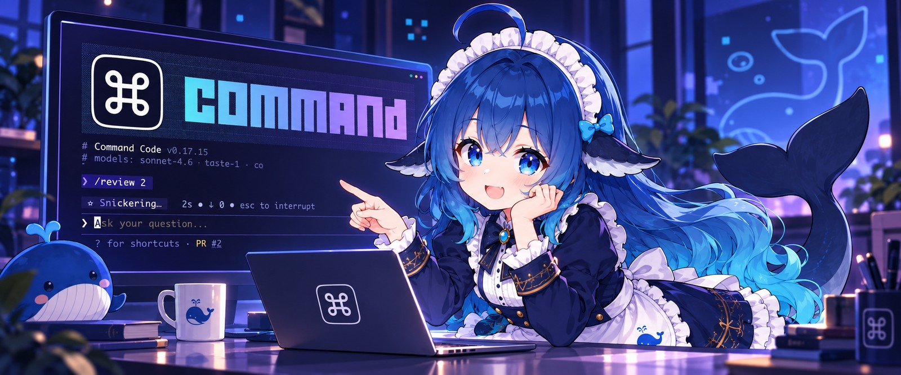
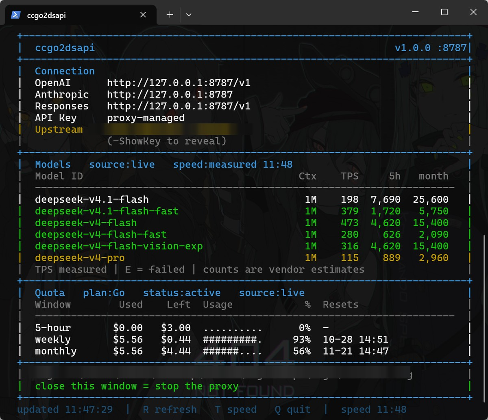

<p align="center">
  
</p>

<h1 align="center">Command Code Go 2 DeepSeek API</h1>

<p align="center">
  <a href="LICENSE"></a>
  <a href="#configuration"></a>
  <a href="#configuration"></a>
  <a href="#configuration"></a>
</p>

<p align="center">
  
  
  
  
</p>

<p align="center">
  <a href="#quick-start">Quick start</a> ·
  <a href="#endpoints">Endpoints</a> ·
  <a href="#clients">Clients</a> ·
  <a href="#differences-from-the-official-docs">Differences</a> ·
  <a href="#quota-panel">Quota panel</a> ·
  <a href="#configuration">Configuration</a> ·
  <a href="#security">Security</a> ·
  <a href="#troubleshooting">Troubleshooting</a> ·
  <a href="README.md">中文</a>
</p>

Serves DeepSeek's three official protocol surfaces from a local endpoint, backed by a Command Code Go plan. Point `base_url` at it and keep your request code unchanged; protocol behaviour is measured against the official docs item by item.

## Why this exists

The Command Code Go plan costs **$1/month**. Their own wording is "Your $1 buys $10 of credits" — a 10x multiplier. Those credits are spent on model calls, and all of them can go to DeepSeek:

| Window | Cap |
|---|---|
| 5 hours | $3 |
| Weekly | $6 |
| Monthly | $10 |

For reference, DeepSeek's own list price ([Models & Pricing](https://api-docs.deepseek.com/quick_start/pricing)) for Flash, per million tokens, off-peak:

| Item | Off-peak | Peak |
|---|---|---|
| Input, cache hit | $0.003 | $0.006 |
| Input, cache miss | $0.15 | $0.30 |
| Output | $0.60 | $1.20 |

At the cache-miss input rate, $10 of credits is about **66 million tokens per month**; at the output rate, about 16 million. Bought directly from the official API, that volume costs $10.

In short: **$1 buys the official $10 of DeepSeek usage**. The trade-off is that traffic runs through Command Code's channel under plan rate limits, not DeepSeek's own infrastructure.

The Go plan only exposes `/alpha/generate` to the official CLI; it has no standard API. This project supplies the translation layer so that $1 of quota can be consumed by any OpenAI / Anthropic / Responses-compatible client — Claude Code, Codex, opencode, pi, DSH.

This is not an official channel. Usage caps, model availability and stability are controlled by Command Code, not DeepSeek, and can change without notice. It suits personal development and experimentation, not production dependencies.

## This only applies to the Go plan

Command Code's own documentation is explicit: **every plan except Go has API access.**

> Every plan except the Go plan has API access.
> Point any OpenAI or Anthropic compatible client at `https://api.commandcode.ai/provider/v1`

| Plan | Official API | Do you need this project? |
|---|---|---|
| **Go** ($1/month) | none | **yes** |
| GOAT ($10/month, $80 of credits) | yes | no |
| Pro / Max / Ultra | yes | no |

On GOAT or above, point your client at `https://api.commandcode.ai/provider/v1` with
the key you already have. No translation layer, no local process. This project exists
for one reason: Go exposes a private endpoint to the official CLI only and offers no
standard API.

## Quick start

Requires Windows 10/11, PowerShell 5.1+, Node.js 24+.

```powershell
.\scripts\install.ps1      # check environment, generate config.json
commandcode login          # log in to the CLI, creates auth.json
.\launch.ps1               # start; the proxy lives as long as the window
```

The panel lists the three local endpoints once it's up. Optional:

```powershell
.\scripts\make-shortcut.ps1   # desktop shortcut
.\scripts\test-proxy.ps1      # self-check
npm run verify                # three-protocol parity verification
```

<p align="center">
  
</p>

## Endpoints

| Protocol | Local address | Official docs |
|---|---|---|
| OpenAI Chat Completions | `http://127.0.0.1:8787/v1` | [create-chat-completion](https://api-docs.deepseek.com/api/create-chat-completion) |
| Anthropic Messages | `http://127.0.0.1:8787` | [anthropic_api](https://api-docs.deepseek.com/guides/anthropic_api) |
| Responses | `http://127.0.0.1:8787/v1` | [responses_api](https://api-docs.deepseek.com/guides/responses_api) |

Use `proxy-managed` as the API key — it is a sentinel the gateway swaps for the real key in `auth.json`. Leaving it empty works too; any other value is forwarded upstream as your own key and returns 401 if the upstream rejects it.

Model names may be written as `deepseek-v4-flash`, `deepseek-v4.1-flash` or `deepseek-flash`. Per the official docs `deepseek-flash` means **V4.1-Flash**, and this project matches that; `deepseek-v4-flash` and `deepseek-v4.1-flash` are two distinct upstream models, each callable directly. `/v1/models` lists everything available with its context window.

**Image input** is available on `deepseek-v4.1-flash`, `deepseek-v4.1-flash-fast` and `deepseek-v4-flash-vision-exp`. `deepseek-v4-flash` and `deepseek-v4-pro` do not see images and answer that none was attached. All three protocols accept images, as either a base64 data URL or an http(s) link.

## Clients

DeepSeek publishes setup guides for eight agents. This project does not restate them — configure per the official guide, then change only the base URL; behaviour is identical.

| Agent | Official guide | What to change locally |
|---|---|---|
| Claude Code | [claude_code](https://api-docs.deepseek.com/quick_start/agent_integrations/claude_code) | `ANTHROPIC_BASE_URL` → `http://127.0.0.1:8787` |
| Codex | [codex](https://api-docs.deepseek.com/quick_start/agent_integrations/codex) | `base_url` → `http://127.0.0.1:8787/v1` |
| OpenCode | [opencode](https://api-docs.deepseek.com/quick_start/agent_integrations/opencode) | `baseURL` → `http://127.0.0.1:8787/v1` |
| Hermes | [hermes](https://api-docs.deepseek.com/quick_start/agent_integrations/hermes) | Base URL → `http://127.0.0.1:8787/v1` |
| OpenClaw | [openclaw](https://api-docs.deepseek.com/quick_start/agent_integrations/openclaw) | Base URL → `http://127.0.0.1:8787/v1` |
| Qoder | [qoder](https://api-docs.deepseek.com/quick_start/agent_integrations/qoder) | custom model Base URL → `http://127.0.0.1:8787/v1` |
| Reasonix | [reasonix](https://api-docs.deepseek.com/quick_start/agent_integrations/reasonix) | Base URL in the first-run wizard → `http://127.0.0.1:8787/v1` |
| WorkBuddy / CodeBuddy | [workbuddy](https://api-docs.deepseek.com/quick_start/agent_integrations/workbuddy) | `url` in `models.json` → `http://127.0.0.1:8787/v1/chat/completions` |

The API key is always `proxy-managed`.

### Switching with CC Switch

[CC Switch](https://github.com/farion1231/cc-switch) manages ten clients; eight of them accept a DeepSeek preset that can point here. Duplicate the DeepSeek preset for the target and change only the address:

| Client in CC Switch | Field to change | Value |
|---|---|---|
| Claude Code | `ANTHROPIC_BASE_URL` | `http://127.0.0.1:8787` |
| Claude Desktop | model mapping Base URL | `http://127.0.0.1:8787` |
| Codex | `base_url` in the TOML | `http://127.0.0.1:8787/v1` |
| OpenCode | `options.baseURL` | `http://127.0.0.1:8787/v1` |
| OpenClaw | provider Base URL | `http://127.0.0.1:8787/v1` |
| Hermes | `base_url` | `http://127.0.0.1:8787/v1` |
| Pi | `baseUrl` | `http://127.0.0.1:8787/v1` |
| MiniMax Code | Base URL in the model config | `http://127.0.0.1:8787/v1` |

Gemini CLI and Grok Build speak their own native protocols, which this project does not implement, so they cannot point here.

### Three things that will bite you

**Claude Code's context declaration.** It sizes context from a built-in model catalogue, so an unfamiliar model name falls back to 200k with a warning. Append `[1M]` to declare the real window; the suffix never reaches upstream:

```powershell
$env:ANTHROPIC_MODEL = "deepseek-v4-flash[1M]"
```

`CLAUDE_CODE_MAX_CONTEXT_TOKENS=1000000` works too.

**OpenCode model ids must not contain slashes.** It addresses models as `provider/model`, so a slash is read as a path separator. Writing `deepseek/deepseek-v4-flash` into `models` gets truncated and returns 403. Use the flat `deepseek-v4-flash` and call with `--model ccgo/deepseek-v4-flash`.

**pi / DeepSeek Harness infer the provider from the URL.** Both run on pi-ai, which checks whether the base URL contains `deepseek.com` to pick a thinking format. A localhost address does not, so declare `compat` explicitly:

```json
{
  "compat": {
    "thinkingFormat": "deepseek",
    "requiresReasoningContentOnAssistantMessages": true,
    "requiresThinkingAsText": false,
    "maxTokensField": "max_tokens",
    "supportsReasoningEffort": true
  }
}
```

For pi, put it in `$env:PI_CODING_AGENT_DIR\models.json`.

## Differences from the official docs

All three protocols are measured item by item; `npm run verify` reproduces this:

```
PASS  OpenAI Chat Completions  0 diffs
PASS  Anthropic Messages       0 diffs
PASS  Responses                0 diffs
```

The deviations worth knowing all stem from what the upstream channel can do:

| Item | Note |
|---|---|
| Billing | Plan window credits ($3 / $6 / $10), not per-token |
| `logprobs` / `top_logprobs` | Upstream returns none; the field is empty |
| `n > 1` | Only one choice is returned |
| `web_search` tool | No server-side search upstream; ignored |
| Files API | No file storage; not implemented |
| FIM completion (`/beta`) | No such upstream endpoint; not implemented |
| Context hard-disk cache | Managed inside upstream; not controllable |

Fields the official API itself marks as "ignored" are ignored here too, without erroring. Each protocol's compatibility section in the official docs lists them; this implementation follows those lists without adding or removing entries.

## Quota panel

A static panel; nothing refreshes on a timer. Benchmarking is **never automatic** — the TPS column shows `-` at startup and is only measured when you press `T`, because each measurement spends quota.

| Key | Action |
|---|---|
| `R` | Refresh quota and actual usage |
| `T` | Measure throughput (small quota cost) |
| `Q` | Quit and stop the proxy |

Four blocks: the three protocol endpoints, the model list (context + measured TPS), the three quota windows (used / left / progress / reset time), and runtime status. TPS turns green above a threshold and yellow below it; `E` means the measurement failed.

Data sources: the model list and context windows come from upstream `/provider/v1/models`; window caps and usage come from `/alpha/billing/credits` (caps are server-supplied, never hardcoded); plan names and monthly totals map from `planId`.

## Implementation

One process, one port, three protocols sharing a single upstream channel. The
protocol layer is written here; there is no third-party dependency.

```
vendor/
  wire.mjs       upstream protocol: headers, wire messages, NDJSON events
  translate.mjs  OpenAI Chat / Anthropic Messages  <->  wire
  responses.mjs  OpenAI Responses                  <->  wire
  server.mjs     HTTP routing for all three
```

Field layouts come from static analysis of the official CLI's published
artifact, recorded claim by claim in
[docs/COMMAND-CODE-PROTOCOL.md](docs/COMMAND-CODE-PROTOCOL.md). Compared with
the earlier implementation that sat on a third-party package, this closes
several deviations:

| Item | Earlier | Now |
|---|---|---|
| `User-Agent` | synthesised CLI string | the official value, `cli` |
| image blocks | no `mimeType` | `mimeType` included |
| `traceparent` | hand-rolled | standard W3C `00-<trace>-<span>-01` |
| truncation | not detected | no `finish` and no `abort` -> retryable 502 |
| reasoning tokens | always 0 | read from `outputTokenDetails.reasoningTokens` |
| Responses | separate process on 8788 | same port as the other two |

Verification comes in two tiers:

```powershell
npm run verify:offline   # offline: mock upstream, 15 assertions, zero quota
npm run verify           # live: against the real upstream, 3/3, small quota cost
```

Use the **offline** suite after code changes — it exercises the same translation
layer against a local mock, so it needs no credentials, spends no plan quota, and
finishes in seconds. The **live** suite is for confirming alignment with the
official API.

```powershell
npm run mock             # start the mock upstream alone (default :8799)
node tools/mock-upstream.mjs --scenario truncated   # force a truncated stream
node tools/mock-upstream.mjs --scenario error       # force an upstream error
```

Two query endpoints sit alongside the protocols:

| Endpoint | Purpose |
|---|---|
| `GET /user/balance` | the official `/user/balance` shape, remaining credit |
| `GET /user/quota` | this project's shape, with 5-hour and weekly windows |

For request forensics, add `--request-log <path>`; each request writes one JSON
Lines record with protocol, model, stream, status, token counts and duration.
Off by default. Upstream 429 and 5xx responses are retried with exponential
backoff (twice by default, `--retries` to change); terminal errors such as an
exhausted quota are not retried.

`/user/quota` returns used, cap, percent and reset time per window, plus the
monthly credit pool.

```json
{
  "plan_id": "individual-go-v1",
  "credits": { "monthly": 5.35, "purchased": 0, "free": 0, "total": 5.35 },
  "windows": {
    "five_hour": { "used": 1.64, "cap": 3, "percent": 55, "reset_at": 1792602021321 },
    "weekly":    { "used": 4.65, "cap": 6, "percent": 77, "reset_at": 1793170293513 }
  }
}
```

## Configuration

`config.json`, copied from `config.example.json` and already in `.gitignore`.

| Field | Meaning |
|---|---|
| `Port` / `HostAddress` | Main proxy listener, defaults `8787` / loopback only |
| `AuthFile` | Credential path; environment variables supported |
| `Upstream.*` | Upstream endpoints; change these to target a different service |
| `Panel.ModelFilter` | Model filter regex, DeepSeek only by default |
| `Panel.SpeedTestModels` | Benchmark scope; empty means all |
| `PlanCredits` | Monthly credit total per plan (the server does not provide it) |

## Security

Listens on `127.0.0.1` only — do not change it to `0.0.0.0`. Do not share the key: upstream binds a device fingerprint to each key, and concurrent use from multiple machines is the most likely trigger for abuse controls. Credentials are read from the `auth.json` the CLI maintains; nothing is uploaded or cached.

The upstream protocol layer is written in this repository (`vendor/`). There is no third-party
Command Code package and no patch step. The protocol was derived from
[static analysis of the official CLI](docs/COMMAND-CODE-PROTOCOL.md). Earlier versions depended on
and were informed by `commandcode-api-proxy` (MIT, by [thaolaptrinh](https://github.com/thaolaptrinh/commandcode-api-proxy));
attribution is retained in [THIRD_PARTY_NOTICES.md](THIRD_PARTY_NOTICES.md).

You accept the risk of account restrictions or plan termination.

## Troubleshooting

| Symptom | Cause |
|---|---|
| TPS shows `-` | Not measured yet; press `T` |
| TPS shows `E` | Measurement failed, usually the model is not in the plan |
| No reasoning content | Request omitted `reasoning_effort`, or set it to `none` |
| 401 | API key is something other than `proxy-managed` |
| 403 / model not recognized | Wrong model name, or not included in the plan |
| Model keeps re-deriving the same conclusion | History thinking is not reaching the context. Requires **both**: the request carries `tools` **and** forwards `reasoning_content` — either one alone does nothing (180-trial result, see protocol doc) |
| `maximum context length` | Conversation exceeds the 1048576-token window; trim history or lower `max_tokens` |
| Port already in use | The launcher takes over its own stale instance; if another program owns it, pass `-Port` |

## Uninstall

```powershell
.\scripts\stop-proxy.ps1
.\scripts\make-shortcut.ps1 -Remove
```

Then delete the project directory. No registry entries, no system service, no PATH changes.

## License

[MIT](LICENSE)
